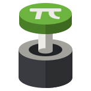

<p align="center">
  
</p>

<h1 align="center">PiSton</h1>

<p align="center">
  <strong>A tiny web panel for your Minecraft server on a Raspberry Pi.</strong><br>
  Start, stop and watch a single Minecraft Java server from your browser – lean enough to run next to the game on a Pi.
</p>

<p align="center">
  <a href="LICENCE"></a>
  
  
</p>

> [!WARNING]
> **Home use on your local network only. There is no login. Never expose PiSton to the internet.**
> Anyone who can reach the panel can control your server. See [Security](#security).

---

## Status

PiSton is in **early development** and cannot manage a server yet. What exists today is the
frontend foundation: design system, base components and the app shell with navigation.
The pages are built next, first with sample data; the Node.js backend follows once the frontend is complete.

Progress is tracked in the [roadmap](PROGRESS.md) (German).

## Features

Planned for the first release:

- **Server control** – start, stop and restart via systemd
- **Live console** – follow `latest.log` in real time and send commands over RCON
- **Settings** – edit `server.properties` in a GUI with validation; comments and order are kept
- **Version switching** – change version and server type with a mandatory world backup first
- **Metrics** – players online, TPS, RAM and CPU of the server process

### Supported server types

| Type | Status |
|---|---|
| Vanilla | planned for v1 |
| Paper | planned for v1 |
| Fabric | planned for v1 |
| Forge / NeoForge | known, not included – shown as “planned” in the UI |
| Bedrock | not planned |

## Design goals

- **One server, one Pi.** No multi-server setup, no hosting for others.
- **Small footprint.** Target under 80 MB RAM for the panel, so a Pi 3B+ can still run it.
- **No build step.** Vanilla HTML, CSS and JavaScript with native ES modules and Web Components.
  Copying the folder is the deployment.
- **Almost no dependencies.** The only planned runtime dependency is [`ws`](https://github.com/websockets/ws);
  the RCON client is written from scratch.
- **Works offline.** Fonts and assets are served locally – nothing is loaded from a CDN.
- **Accessible.** Keyboard navigation, visible focus, status shown with text and shape, never by colour alone.

## Requirements

| | |
|---|---|
| Hardware | Raspberry Pi 4B (8 GB) recommended; the panel itself also runs on a Pi 3B+ |
| OS | Raspberry Pi OS 64-bit |
| Panel | Node.js 24 LTS (22 or newer) |
| Minecraft | Java 25 for Minecraft 26.x, Java 21 for 1.20.5 – 1.21.11 |

The Minecraft server is expected in `/opt/minecraft`, owned by a `minecraft` user and running as
`minecraft.service` with RCON enabled. Installation instructions will follow with the first release.

## Security

PiSton has no accounts and no login by design. Protection comes from keeping it inside your home network:

- The panel binds to the Pi's **LAN IP** by default, not to `0.0.0.0`.
- **Never forward** the panel port (default `8080`) or the RCON port (`25575`) in your router.
  Only the game port `25565` may be forwarded if friends outside your network should join.
- The RCON password never leaves the backend and is never sent to the browser.
- The panel may only run three commands as root: `systemctl start|stop|restart minecraft.service`
  (via a narrow sudoers rule).
- WebSocket connections are checked against the page origin, so other websites cannot control the panel from your browser.

A firewall that only allows your local network is recommended, for example with `ufw`
(adjust the subnet to your network):

```sh
sudo ufw default deny incoming
sudo ufw allow from 192.168.1.0/24 to any port 22 proto tcp    # SSH from the LAN
sudo ufw allow from 192.168.1.0/24 to any port 8080 proto tcp  # PiSton from the LAN
sudo ufw allow 25565/tcp                                       # Minecraft
sudo ufw enable
```

## Development

There is no backend yet, so the frontend can be previewed with any static file server.
It has to be served over HTTP because ES modules do not load from `file://`.

```sh
git clone https://github.com/BlackPhantomDev/piston.git
cd piston
python3 -m http.server 8080 --directory public
```

Then open <http://localhost:8080> for the panel and <http://localhost:8080/components.html>
for an overview of all components and their states.

### Project structure

```
public/
├─ index.html          app shell: sidebar, navigation, content
├─ components.html     component overview
├─ main.css            stylesheet entry point
├─ css/                tokens, base styles, components, layout
├─ js/
│  ├─ main.js          entry point
│  ├─ router.js        hash routing (#/home, #/konsole, #/einstellungen)
│  ├─ components/      Web Components (<mc-toggle>, <status-badge>, …)
│  ├─ i18n/            UI strings
│  └─ pages/           one module per page
└─ assets/             logo and fonts
```

The UI is currently in German. All strings live in `public/js/i18n/`, and the language switch
in the sidebar is ready – English only needs a translation file.

## License

Copyright © 2026 Mischa S.

PiSton is free software, licensed under the
[GNU Affero General Public License v3.0 or later](LICENCE), with
[additional terms under Section 7](ADDITIONAL_TERMS):

1. **Attribution** – every page of the web interface must show “Powered by PiSton” with a working
   link to this repository. It may not be removed or hidden.
2. **Modified versions** must be marked as modified and may not be presented as the original PiSton.
3. **No trademark rights** to the name “PiSton” or its logo are granted.

If you run a modified version for others over a network, the AGPL requires you to offer them its source code.

The bundled fonts (Inter, JetBrains Mono, Pixelify Sans) are licensed under the SIL Open Font License 1.1 –
see [THIRD-PARTY-NOTICES](THIRD-PARTY-NOTICES).

---

<sub>Not an official Minecraft product. Not approved by or associated with Mojang or Microsoft.</sub>
